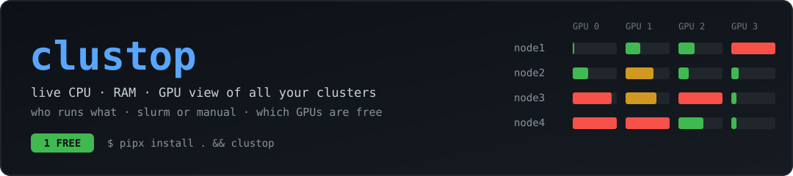

<p align="center"></p>

# clustop

**One terminal window that shows what every GPU server in your cluster is doing right now.**

Think `htop` + `nvitop`, but for a whole cluster at once (any set of SSH-reachable GPU machines, saved as profiles): CPU, RAM, every
GPU, who is using it, and whether the job came from Slurm or someone running it by hand.
Most importantly, it tells you **which GPUs are free**.

```
 clustop  3/4 hosts · 12 GPUs · avg util 48% · VRAM 212G/566G · free: node1:0, node2:3   q quit · space pause · +/- 2s
╭──────────────────────── node1  10.0.0.1   1/4 GPU free ────────────────────────╮
│ CPU ██░░░░░░░░░░░░░░░░░░░░░░    6%  ld 9.1/128c                                    │
│ RAM ███░░░░░░░░░░░░░░░░░░░░░    9%  23.0G/250.9G                                   │
│                                                                                     │
│  GPU  Name  Util             Memory                  T    Who  (S=slurm M=manual)   │
│  0    A30   ░░░░░░░░░░   0%  ░░░░░░░░░░ 1.0G/24.0G  28°   FREE                      │
│  1    A30   ███░░░░░░░  33%  ░░░░░░░░░░ 508M/24.0G  25°  1p alice:M           │
│  3    A30   ██████████ 100%  ██░░░░░░░░ 3.5G/24.0G  49°  3p hmslati:S                │
╰─────────────────────────────────────────────────────────────────────────────────────╯
 GPU processes (by memory)
 Host    GPU  User     PID      GPU mem  Src           Time        Command
 node4    1  awhite   23879    83.3G    slurm 57381   3-04:30:58  python .../train.py
```

## Quick start

You need Python 3.11+ and `pipx` (`brew install pipx` on a Mac).

```bash
git clone https://github.com/aipyth/clustop && cd clustop
pipx install .

clustop profile add mycluster 10.0.0.1 10.0.0.2 10.0.0.3 --user YOUR_USER --default
clustop
```

(or skip the profile for a quick look: `clustop 10.0.0.1 10.0.0.2`)

On first start it asks for your SSH password **once per server**. After that it
keeps the connections open for 8 hours, so the next launches start without
asking again.

Want to skip passwords entirely? Copy your SSH key to each server once:

```bash
ssh-copy-id YOUR_USER@10.0.0.1   # repeat for the other servers
```

Make sure the right username is used: put this in `~/.ssh/config`:

```
Host 10.0.0.1 10.0.0.2 10.0.0.3 10.0.0.4
  User YOUR_USER
```

## What you're looking at

**Header**: how many servers answered, total GPUs, average GPU utilization, total
VRAM in use, and a list of every free GPU as `host:index`.

**One panel per server**
| Part | Meaning |
|---|---|
| `CPU` | Overall CPU use and the 1-minute load average next to the number of cores (`ld 9.1/128c`). |
| `RAM` | Memory in use (not counting reclaimable cache) out of total. |
| `Util` | How busy the GPU's compute units are. |
| `Memory` | GPU memory used / total. |
| `T` | GPU temperature. |
| `Who` | Number of processes on this GPU and their users. `:S` = started by Slurm, `:M` = started manually (ssh, Jupyter, a screen session...). |

Bars turn **green → yellow → red** as things fill up.

**GPU status in the `Who` column**
- **`FREE`** (green badge): no process on it, under 5% utilization and under 1 GB
  of memory in use. Safe to grab.
- **`3p alice:S bob:M`**: three processes, from alice (Slurm) and bob (manual). The GPU is shared.
- **`busy, proc not visible`**: the GPU is in use but no process shows up, which can
  happen with some containers. Treat it as taken.

**Process table (bottom)**: every process using a GPU, across all servers, biggest
memory user first. `Src` says `slurm <jobid>` or `manual`.

## Keys and options

| Key | Action |
|---|---|
| `q` | quit |
| `space` | pause / resume updating |
| `+` / `-` | slower / faster refresh (0.5 s to 60 s) |

```bash
clustop                          # your default profile, refresh every 2 s
clustop -i 5                     # refresh every 5 s
clustop -p lab                   # another profile (see Profiles)
clustop 10.0.0.1 10.0.0.4  # only these servers
```

## Profiles (multiple clusters)

A profile is a named list of servers. Create one per cluster, make one the default,
and plain `clustop` opens it:

```bash
clustop profile add lab 10.0.0.1 10.0.0.2 --user bob      # create a profile
clustop profile add lab 10.0.0.1 10.0.0.2 -u bob --default # ...and make it the default
clustop profile list                                       # * marks the default
clustop profile default lab                                # change the default
clustop profile show lab
clustop profile remove lab
clustop profile path                                       # where the config file lives

clustop                 # runs the default profile (set one up first, see below)
clustop -p lab          # runs a specific profile
clustop -p lab -u alice # same, with another ssh user
clustop 10.1.1.5 10.1.1.6   # ad-hoc hosts, no profile needed
```

Options per profile: `hosts` (required), `user` (ssh user; otherwise your
`~/.ssh/config` decides) and `interval` (refresh seconds; `-i` on the command
line overrides it). The active profile name is shown in the header.

Profiles are stored in `~/.config/clustop/config.toml` (created on first run), so you
can also edit it by hand:

```toml
default = "gpu-lab"

[profiles.gpu-lab]
hosts = ["10.0.0.1", "10.0.0.2", "10.0.0.3", "10.0.0.4"]

[profiles.lab]
hosts = ["10.0.0.1", "10.0.0.2"]
user = "bob"
interval = 5.0
```

Set `CLUSTOP_CONFIG=/path/to/file.toml` to use a different config file, for example
one shared by your team in a git repo. To switch profiles, quit and start it again with `-p`.

## How it works (and what it touches)

- It runs plain `ssh` from your laptop. **Nothing is installed on the servers**
  and nothing is written there.
- Every refresh it runs one small read-only script on each server: it reads
  `/proc` (CPU, memory), calls `nvidia-smi` (GPUs and their processes) and `ps`
  (who owns them).
- Slurm jobs are recognized from each process's cgroup path
  (`.../slurmstepd.scope/job_12345/...`). The `squeue` command isn't needed.
- If `nvidia-smi` hangs on a node (it happens when a driver is unhappy), it is
  cut off after 8 seconds and you still see that server's CPU and RAM, with a red
  note instead of GPU rows.
- The server list comes from your profile (see Profiles above).

## Troubleshooting

| Problem | Fix |
|---|---|
| `could not connect (wrong password / unreachable)` | Check your VPN/network and try `ssh YOUR_USER@10.0.0.1` by hand. Then restart `clustop`. |
| A server shows `Permission denied` after a while | The saved connection expired. Quit and start `clustop` again. |
| A server is red with `timed out` | The machine or its GPU driver is unresponsive. Others keep updating. |
| `clustop: command not found` | Run `pipx ensurepath` and open a new terminal. |
| Colors/bars look odd | Use a modern terminal (iTerm2, Terminal.app, Ghostty, Kitty) with a UTF-8 font. |
| Want to drop all saved connections | `rm ~/.ssh/clustop-*` |

## Updating or uninstalling

```bash
cd clustop && pipx install --force .   # update after changing the code
pipx uninstall clustop                 # remove
```

## Project layout

```
clustop/
├── pyproject.toml        # package + the `clustop` command
├── README.md
└── clustop/
    ├── app.py            # ssh polling, parsing, rendering
    └── config.py         # profiles and the `clustop profile` command
```

Requires: Python 3.11+, [`rich`](https://github.com/Textualize/rich) (installed
automatically), and `ssh` on your PATH. Works on macOS and Linux.

## License

MIT, see [LICENSE](LICENSE).
